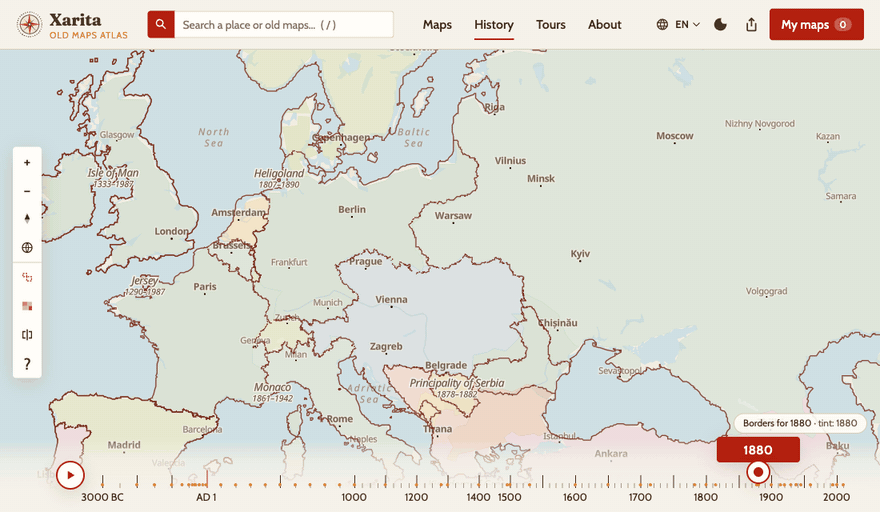
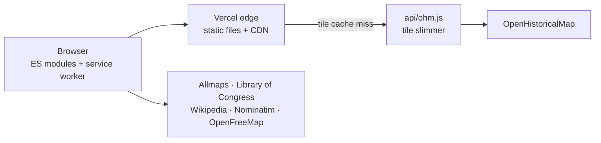

# Xarita

**Drag a timeline through 5,000 years and watch the world's borders redraw, then lay
a 200-year-old map from a library over today's streets.**

[](https://github.com/mountstorm/Xarita/actions/workflows/ci.yml)
[](https://xarita-atlas.vercel.app)
[](LICENSE)

**Live:** https://xarita-atlas.vercel.app



*Xarita* means "map" in Uzbek. Made by Muhammad Sodiq Khaydarov in Tashkent, built
with generative AI coding tools.

## What it does

- **Borders for any year**, 3000 BC to today, filtered to the exact year where the data has dates
- **Scanned maps from 15+ libraries** (David Rumsey, NYPL, National Library of Scotland, BnF,
  the Bodleian, Stanford, Library of Congress and others), found by the area on screen
- **Old maps on today's map**: warp a georeferenced scan onto real coordinates and fade between them
- **Quiz yourself** on any region, with questions generated from the data on screen
- **Guided tours**, compare two years side by side, deep zoom into any scan
- **English, Uzbek and Russian**, including border names and Wikipedia summaries
- **Works offline** after one visit, on phone, tablet and desktop
- **Shareable links**: year, position, language, overlay and opacity all live in the URL

## Numbers

| | Before (Nov 6) | After |
|---|---|---|
| Heaviest OpenHistoricalMap tile (Europe, zoom 3) | 2.1 MB | 247 KB |
| 10 sample tiles, total (`npm run bench`) | 9.8 MB | 1.8 MB (−82%) |
| All 49 border snapshots (brotli) | 20.1 MB | 2.2 MB |
| Largest content paint, live site, fast 4G | 2.9 s | 0.96 s |
| First border data on screen, live site, fast 4G | 11.4 s | 0.74 s |
| Main thread blocked while loading, fast 4G | 2.4 s | 0 s |
| Data downloaded on a reload | 1.7 MB | 6 KB |

**Lighthouse, mobile profile** (mid-range phone: 4× slower CPU, 1.6 Mbps throttled network):

| | Performance | Accessibility | Best practices | SEO | Largest paint | Blocking time |
|---|---|---|---|---|---|---|
| Before (production) | 40 | 96 | 100 | 100 | 6.0 s | 2,620 ms |
| After (production) | 100 | 100 | 100 | 100 | 1.1 s | 60 ms |

Measured on the live site on 2026-11-19. Performance scored 95–100 across three runs;
the table shows the median run. Full reports are in [`docs/lighthouse/`](docs/lighthouse/).

## Architecture



A static site plus one serverless function. The browser does the work; the function
rewrites OpenHistoricalMap tiles to keep only what the map draws, and Vercel's CDN
caches the result for a month. Details, including what is cached where and for how
long: **[docs/architecture.md](docs/architecture.md)**.

## Why it's built this way

Three decisions shape the project, each written up with what it costs:

- [No framework, no bundler](docs/adr/0001-no-framework-no-bundler.md): about 56 KB of
  app code, nothing to build, and what we give up for it.
- [Hand-rolled protobuf instead of a vector-tile library](docs/adr/0002-hand-rolled-protobuf.md):
  why the tile function copies geometry as raw bytes, and how the risk is tested.
- [Border snapshots plus OpenHistoricalMap](docs/adr/0003-snapshots-plus-ohm.md): how
  year accuracy is balanced against the data that actually exists.

## Run it

Needs Node 22 or newer.

```bash
npm install
npm run dev
```

Then open http://localhost:5173. The dev server has no dependencies and runs the tile
function in-process, so no Vercel account is needed.

| Script | What it does |
|---|---|
| `npm run dev` | Local server with the tile function |
| `npm test` | 31 unit tests (Node's built-in runner) |
| `npm run lint` | Biome lint and format check |
| `npm run typecheck` | JSDoc type checking with `tsc` |
| `npm run check:size` | Fails if any shipped file goes over its size budget |
| `npm run verify` | All of the above; this is what CI runs |
| `npm run bench` | Raw vs slimmed size for 10 live tiles |
| `npm run build:data` | Rebuilds the border snapshots and basemap style |

## Known limitations

- **Coverage is uneven.** OpenHistoricalMap is crowd-mapped: rich for Europe and the
  Americas, thin for Central Asia and the ancient world. Where it's thin, a coarser
  dated snapshot fills in, and the map says so ("Borders for 1862 · tint: 1815").
- **Snapshots are approximate.** 49 snapshots over 5,000 years means borders between
  them are a best guess, and pre-modern frontiers were rarely sharp lines anyway.
- **Disputed borders get one line.** Both sources draw a single line where countries
  disagree; Xarita doesn't yet show competing claims.
- **It depends on outside services.** OpenHistoricalMap, Allmaps, the Library of Congress,
  Wikipedia, Nominatim and OpenFreeMap. Borders you've seen keep working offline; the
  library search doesn't.
- **Some library records are incomplete.** A few libraries don't publish titles or dates
  in a machine-readable way, so their maps show as "Map from …" and undated.
- **Some names stay in English.** Snapshot region names are English-only, so a few quiz
  answers aren't translated.

## Data and credits

Borders: [OpenHistoricalMap](https://www.openhistoricalmap.org) (CC0) and
[historical-basemaps](https://github.com/aourednik/historical-basemaps) (GPL-3.0, see
[`data/LICENSE`](data/LICENSE)). Scans: [Allmaps](https://allmaps.org) and the libraries
behind it, and the [Library of Congress](https://www.loc.gov/maps/). Basemap:
[OpenFreeMap](https://openfreemap.org). Rendering: [MapLibre GL JS](https://maplibre.org)
and [OpenSeadragon](https://openseadragon.github.io).

Code is MIT-licensed; see [LICENSE](LICENSE).
