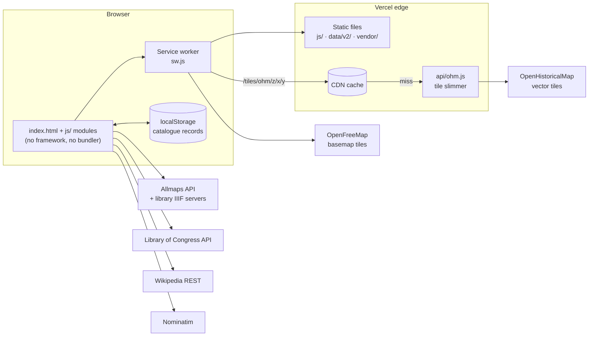

# Architecture

Xarita is a static site plus one small serverless function. The browser does almost
all the work; the function exists only to make OpenHistoricalMap tiles small and
cacheable.

## Request flow

## What is cached where, and for how long

| What | Where | How long | Why |
|---|---|---|---|
| `index.html`, `js/*.js` | Browser, revalidated every load | 0 (ETag) | A deploy must reach everyone at once; modules aren't fingerprinted. |
| `styles.css?v=N` | Browser | 1 year, immutable | Versioned in the URL; bump `N` to ship a change. |
| `data/v2/*`, `vendor/*` | Browser + CDN | 1 year, immutable | Versioned by folder. A rebuild goes to `data/v3/`, never over v2. |
| Slimmed OHM tiles | CDN | 30 days (+7 days stale-while-revalidate) | Upstream allows only 60 s; history changes slowly. |
| Slimmed OHM tiles | Browser | 1 day | Short enough that edits to OpenHistoricalMap still arrive. |
| Everything above | Service worker | Until the next deploy (shell) / LRU of 600 (tiles) | Works offline after one visit. |
| Allmaps and LoC catalogue records | `localStorage` | 30 days (1 day for failed lookups) | The slowest part of the panel; records rarely change. |
| Allmaps area results | `localStorage` | 24 hours, last 25 views | Revisiting a view skips the area query. |

## The tile slimmer (`api/_ohm-slim.js`)

OpenHistoricalMap tiles carry every boundary ever mapped with 200+ language names
per label: up to 2 MB per tile. The function:

1. fetches the upstream tile (gzip-decoded by `fetch`),
2. walks the protobuf by hand: layers, features, tags,
3. keeps only `land_ohm_lines` and `land_ohm_centroids`, only administrative
   features up to national level (state level from zoom 5), and only the keys the
   map reads (`type`, `admin_level`, dates, `name`, `name_en/uz/ru`, `area`),
4. at zoom ≤ 8, snaps line vertices to a 512-px grid and drops repeats,
5. returns gzip with CDN cache headers.

Measured on 10 real tiles (`npm run bench`): 9.8 MB → 1.8 MB, 82% smaller, in
1–230 ms per tile. Why there's no library: [ADR 0002](adr/0002-hand-rolled-protobuf.md).

## Border data (`data/v2/`)

`tools/build-data.mjs` downloads the historical-basemaps snapshots at a pinned
commit, runs mapshaper (clean, then topology-aware simplify), precomputes a label
point inside each shape, and writes one JSON per snapshot. 49 files, 2.2 MB
brotli in total. `npm run check:size` fails the build if any file goes over 200 KB.
How the snapshots and OHM work together: [ADR 0003](adr/0003-snapshots-plus-ohm.md).

## Front-end modules (`js/`)

Native ES modules, loaded with `<script type="module">` and `modulepreload` hints
so the browser fetches them in parallel. No build step: [ADR 0001](adr/0001-no-framework-no-bundler.md).

| Module | Responsibility |
|---|---|
| `main.js` | Boot order: wire the UI, read the URL, start the map |
| `state.js` | App state, translations (`t`), toasts, screen-reader announcements |
| `map.js` | MapLibre setup, basemap tint, border layers, year filter, snapshot loading |
| `timeline.js` | Timeline drag, play, year input |
| `regions.js` | Region cards (OHM or snapshot), Wikipedia summaries in the UI language |
| `panel.js`, `sources.js` | Library search (Allmaps by area, LoC by name), caching, progressive render |
| `overlay.js`, `viewer.js` | Warping a scan onto the map (Allmaps), deep zoom (OpenSeadragon, lazy) |
| `quiz.js`, `hero.js`, `tours-ui.js`, `compare.js`, `search.js`, `ui.js` | Features and wiring |
| `lib/*.js` | Pure, DOM-free logic with unit tests: time scale, geometry, text, catalogue parsing |
| `data/*.js` | Strings (en/uz/ru), tours, hero eras |

Only `lib/`, `api/` and `tools/` are type-checked (`// @ts-check` + JSDoc, run by
`tsc` in CI). The DOM modules are linted but not type-checked yet.

## Quality gates (`npm run verify`, also in CI)

- **Biome**: lint (including undeclared and unused variables) and formatting
- **tsc**: JSDoc type checking of the pure code
- **node:test**: 31 tests, no test dependencies
- **Size budget**: per-file and total brotli limits
